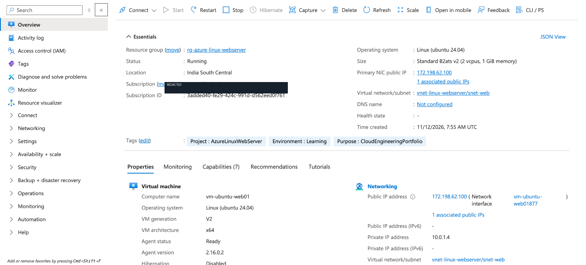
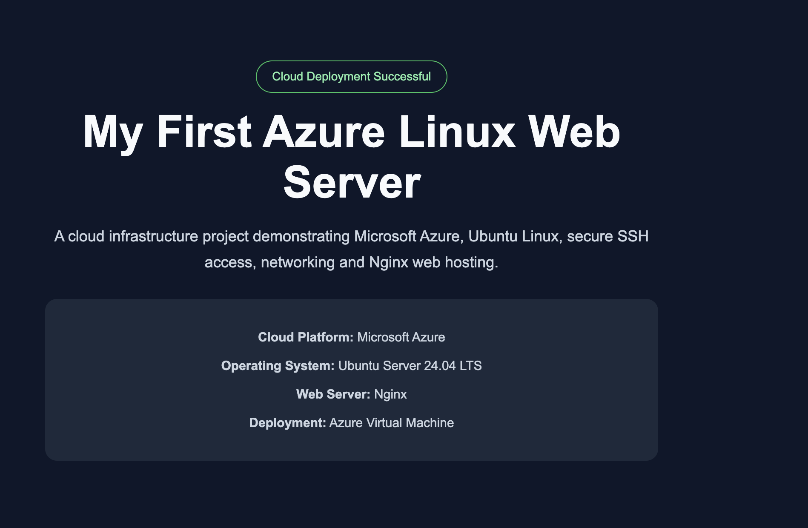
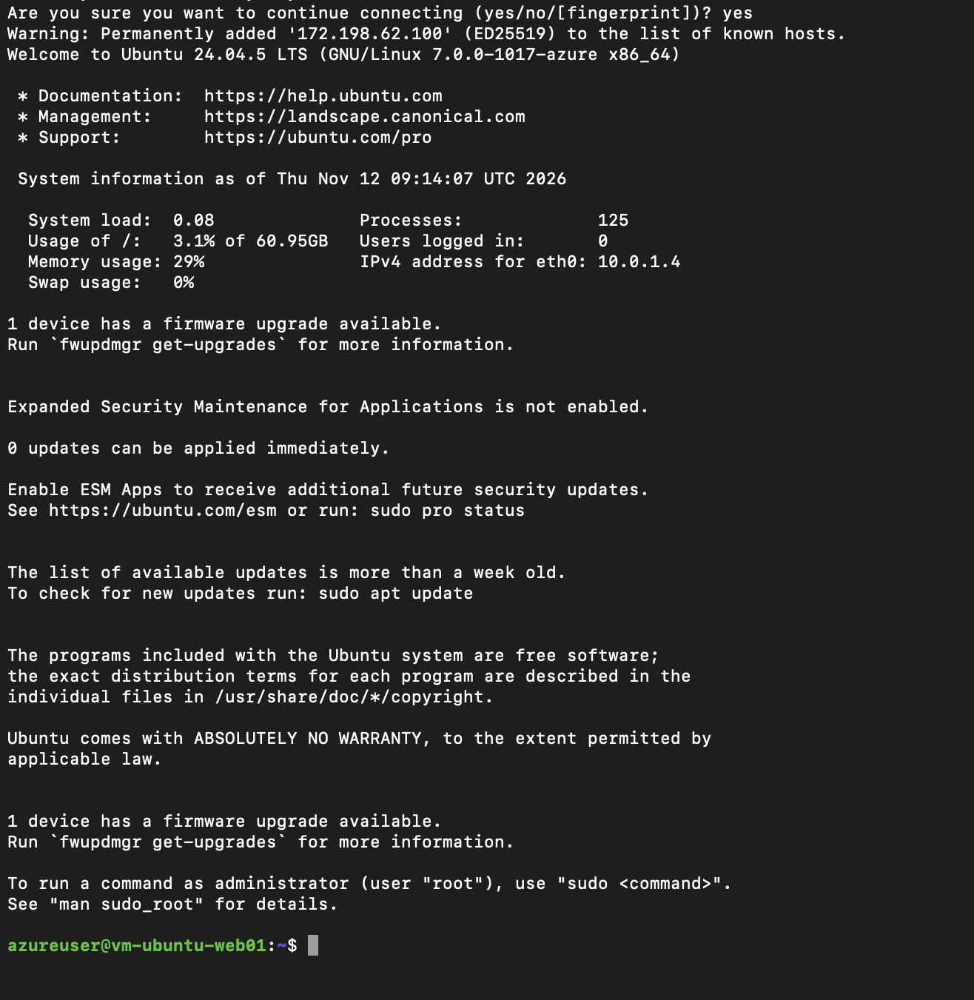
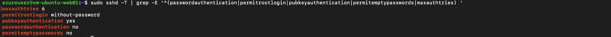
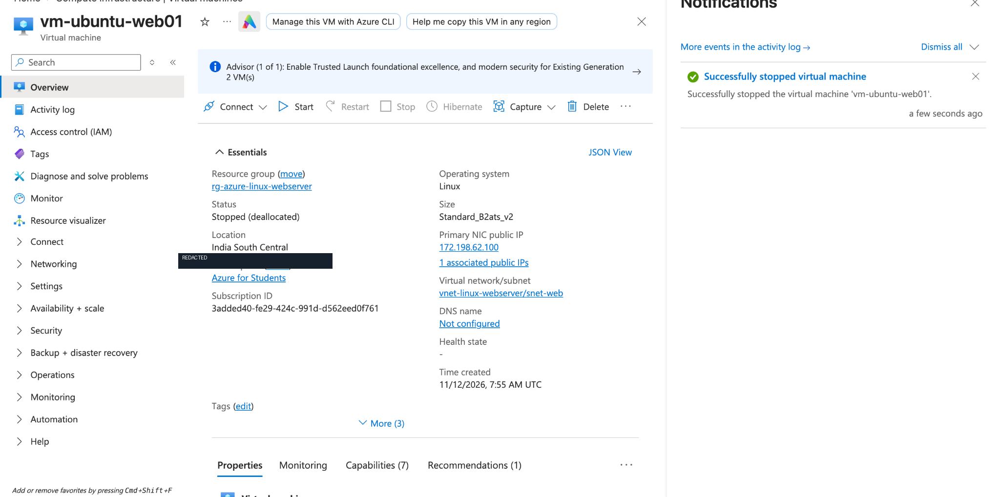

# Azure Linux Web Server — Cloud Infrastructure Project

A hands-on cloud engineering project demonstrating the deployment, configuration, security, and monitoring of an Ubuntu Linux web server on Microsoft Azure.

This project focuses on practical cloud infrastructure skills, including Azure networking, Linux system administration, SSH security, firewall configuration, Nginx deployment, and troubleshooting.

## Project Objectives

- Deploy and administer an Ubuntu Linux virtual machine on Microsoft Azure.
- Configure a virtual network, subnet, and Network Security Group.
- Implement secure SSH key-based remote administration.
- Deploy an Nginx web server and host a custom HTML/CSS website.
- Apply host-level firewall rules and SSH security hardening.
- Monitor system performance, services, and network connections.
- Document the infrastructure and deployment process.

## Technology Stack

| Category | Technology |
|---|---|
| Cloud Platform | Microsoft Azure |
| Operating System | Ubuntu Server 24.04 LTS |
| Virtual Machine | Standard_B2ats_v2 |
| Web Server | Nginx 1.24.0 |
| Networking | Azure VNet, Subnet, Public IP |
| Network Security | Azure Network Security Group |
| Host Firewall | UFW |
| Remote Administration | OpenSSH |
| System Management | systemd, APT |
| Monitoring | Linux CLI tools and Nginx logs |
| Version Control | Git and GitHub |

## Infrastructure Architecture

The project uses a single Ubuntu virtual machine hosted in Microsoft Azure.

The virtual machine is deployed inside a dedicated virtual network and subnet. An Azure Network Security Group controls incoming traffic, while UFW provides an additional host-level firewall.

**Architecture diagram:** [View Azure Infrastructure Architecture](architecture/azure-architecture.md)

## Technical Documentation

Detailed technical documentation is available below:

| Document | Description |
|---|---|
| [Deployment Guide](docs/deployment-guide.md) | Azure infrastructure provisioning, Ubuntu setup and Nginx deployment. |
| [Security Configuration](docs/security-configuration.md) | Azure NSG, Ubuntu UFW, SSH authentication and server hardening. |
| [Troubleshooting Guide](docs/troubleshooting.md) | Real issues, investigation steps, solutions and lessons learned. |

### Azure Resources

| Resource | Configuration |
|---|---|
| Resource Group | `rg-azure-linux-webserver` |
| Region | India South Central |
| Virtual Network | `vnet-linux-webserver` |
| VNet Address Space | `10.0.0.0/16` |
| Subnet | `snet-web` |
| Subnet Address Range | `10.0.1.0/24` |
| Network Security Group | `nsg-linux-webserver` |
| Virtual Machine | `vm-ubuntu-web01` |
| Operating System | Ubuntu Server 24.04 LTS |
| VM Size | Standard_B2ats_v2 |
| OS Disk | 64 GiB Premium SSD |
| Public IP | Standard Static IPv4 |
| Web Server | Nginx |

## Security Implementation

### Azure Network Security Group

The subnet-associated NSG uses the following custom inbound rules:

| Rule | Port | Source | Action |
|---|---|---|---|
| Allow-SSH-MyIP | TCP 22 | Trusted administrator IP | Allow |
| Allow-HTTP-Web | TCP 80 | Any | Allow |

Other traffic remains subject to the NSG's remaining rules, including Azure default rules.

### SSH Hardening

The OpenSSH server was configured and validated with:

- Password authentication disabled.
- Public-key authentication enabled.
- Direct root SSH login disabled.
- Maximum authentication attempts set to 3.
- SSH access restricted at the Azure NSG to a trusted administrator IP.

SSH configuration changes were tested before reloading the service, followed by a successful fresh SSH connection.

### Ubuntu UFW Firewall

The host-level firewall was enabled with:

- Default incoming policy: Deny
- Default outgoing policy: Allow
- TCP Port 22: Allow
- TCP Port 80: Allow

Both SSH access and public HTTP connectivity were successfully verified after enabling UFW.

## Web Server Deployment

Nginx was installed using Ubuntu's APT package manager.

The default document root was verified as:

`/var/www/html`

A custom HTML/CSS website was deployed using:

`/var/www/html/index.html`

The website was successfully accessed through the virtual machine's public IP address using HTTP.

### Deployment Verification

The following checks were completed:

- Nginx service active and running.
- Nginx enabled for automatic startup.
- Local HTTP request returned `200 OK`.
- Public website successfully displayed in a browser.
- Custom HTML page rendered successfully.

## Deployment Evidence

The following screenshots document the Azure deployment, web hosting, SSH administration, security configuration, and VM lifecycle management.

### 1. Azure Virtual Machine Overview

### 2. Custom Nginx Website

### 3. SSH Remote Administration

### 4. SSH Hardening

### 5. Virtual Machine Deallocation

## System Monitoring and Troubleshooting

Linux commands used during the project:

| Command | Purpose |
|---|---|
| `uptime` | View system uptime and load averages |
| `free -h` | Monitor memory usage |
| `df -h /` | Check disk utilization |
| `top` | Monitor running processes |
| `systemctl` | Manage Linux services |
| `ss -tulnp` | Inspect listening network ports |
| `journalctl` | Inspect systemd journal logs |
| `tail` | Inspect recent Nginx log entries |

Nginx access and error logs were inspected to understand HTTP requests, response codes, and basic troubleshooting.

## Key Learning Outcomes

This project provided hands-on experience in:

1. Microsoft Azure infrastructure provisioning.
2. Virtual network and subnet configuration.
3. Azure NSG traffic filtering.
4. Linux virtual machine administration.
5. SSH key-based remote access.
6. Linux software and service management.
7. Nginx web server installation and configuration.
8. Linux firewall configuration and SSH hardening.
9. Basic infrastructure monitoring and troubleshooting.
10. Cloud resource lifecycle and cost management.

## Cost Management

This project was deployed using an Azure for Students subscription.

Cost-conscious practices included:

- Selecting resources with consideration for student free-service allowances.
- Reviewing public IP pricing before deployment.
- Avoiding unnecessary additional Azure services.
- Deallocating the virtual machine when practical work was completed.

**Note:** Deallocating a virtual machine stops compute billing, but retained resources such as managed disks and public IP addresses may still incur charges.

## Current Project Status

- [x] Azure infrastructure deployed
- [x] Ubuntu Linux VM configured
- [x] SSH remote access established
- [x] Nginx installed and verified
- [x] Custom HTML website deployed
- [x] Azure NSG and UFW configured
- [x] SSH hardening completed
- [x] Basic server monitoring completed
- [x] VM deallocated after testing
- [x] Architecture diagram
- [x] Deployment screenshots
- [ ] Detailed technical documentation
- [ ] HTTPS implementation

## Future Improvements

- Configure a domain name and HTTPS/TLS certificates.
- Implement structured infrastructure monitoring and alerts.
- Introduce automated deployment using Infrastructure as Code.
- Implement backup and recovery procedures.
- Build a repeatable deployment workflow.

## Author

**Mohomed Nasif**

Computer Systems Engineering Undergraduate

Cloud & Infrastructure Engineering Enthusiast

---

*This repository documents a practical cloud infrastructure learning project. It is not presented as a production-certified or fully security-audited deployment.*
