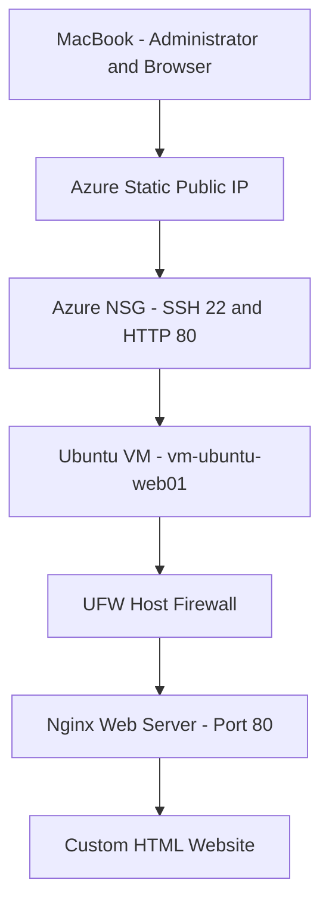

# Azure Linux Web Server Architecture

## Azure Infrastructure Details

- Region: India South Central
- Resource Group: `rg-azure-linux-webserver`
- VNet: `vnet-linux-webserver` (`10.0.0.0/16`)
- Subnet: `snet-web` (`10.0.1.0/24`)
- NSG: `nsg-linux-webserver` (associated with subnet)
- VM: `vm-ubuntu-web01`
- Private IP: `10.0.1.4`
- Public IP: Standard Static IPv4
- OS: Ubuntu Server 24.04 LTS
- Web server: Nginx

**Note:** This is a simplified logical architecture diagram.
The public IP is associated with the VM network interface.
The NSG filters subnet traffic and UFW filters traffic on the VM.
  
