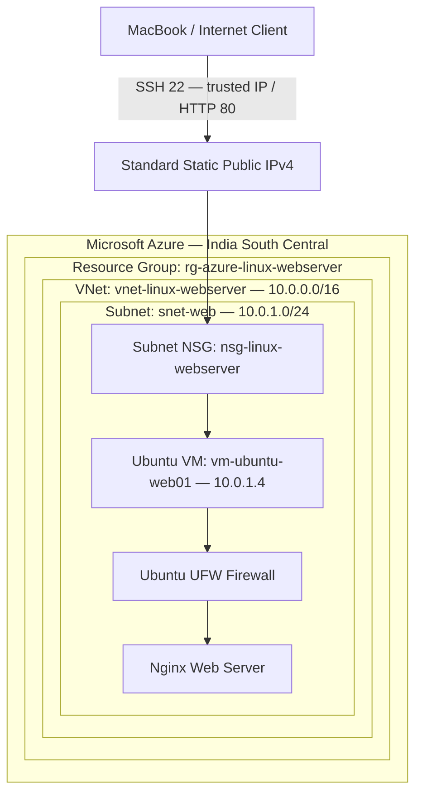

# Azure Linux Web Server Architecture

The diagram represents the logical traffic path. The Standard Static Public IP is associated with the VM's network interface, and the NSG is associated with the subnet.
  
